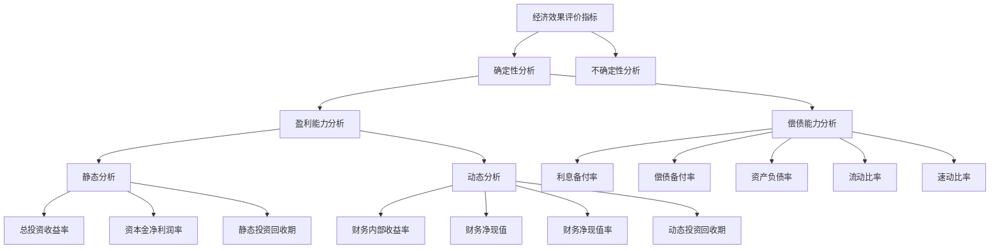

# 技术方案经济效果评价

> [!important] 考点说明
> - **重要程度**：⭐⭐⭐⭐⭐
> - **历年分值**：6-8分
> - **考察形式**：单选 + 多选 + 计算
> - **真题年份**：每年必考，分值占比高

---

## 一、经济效果评价的内容

### 1. 评价内容
- **盈利能力**：财务内部收益率、财务净现值、静态投资回收期、总投资收益率、资本金净利润率
- **偿债能力**：利息备付率、偿债备付率、资产负债率、流动比率、速动比率
- **财务生存能力**：分析是否有足够的净现金流量维持正常运营

### 2. 评价方案类型
- **独立型方案**：方案间互不干扰，选择一个不影响另一个
- **互斥型方案**：方案之间相互排斥，只能选一个

---

## 二、经济效果评价指标体系

---

## 三、核心指标详解

### 1. 财务净现值（FNPV）

#### 概念
用预定的基准收益率（或设定的折现率）$i_c$，分别把整个计算期间内各年所发生的净现金流量都折现到技术方案开始实施时的现值之和。

#### 计算公式
$$FNPV = \sum_{t=0}^{n} (CI - CO)_t (1 + i_c)^{-t}$$

#### 判别准则
- $FNPV \geq 0$：方案可行
- $FNPV < 0$：方案不可行

> [!tip] 优点
> - 考虑了资金的时间价值
> - 全面考虑了技术方案在整个计算期内现金流量的时间分布状况
> - 经济意义明确直观

> [!warning] 不足
> - 必须先确定基准收益率
> - 互斥方案寿命不等时不能直接比较
> - 不能反映单位投资的使用效率
> - 不能直接说明投资回收速度

### 2. 财务内部收益率（FIRR）

#### 概念
使技术方案在计算期内各年净现金流量的现值累计等于零时的折现率。

#### 计算公式
$$FNPV(FIRR) = \sum_{t=0}^{n} (CI - CO)_t (1 + FIRR)^{-t} = 0$$

#### 判别准则
- $FIRR \geq i_c$：方案可行
- $FIRR < i_c$：方案不可行

> [!tip] 优点
> - 考虑了资金的时间价值
> - 能反映投资过程的收益程度
> - 不受外部参数影响，完全取决于投资过程现金流量

> [!warning] 不足
> - 计算麻烦
> - 对于非常规现金流量的项目，可能不存在或存在多个内部收益率

### 3. 基准收益率（$i_c$）

> [!note] 测定基准收益率应考虑的因素
> - 资金成本
> - 机会成本
> - 投资风险
> - 通货膨胀

### 4. 静态投资回收期（$P_t$）

#### 概念
在不考虑资金时间价值的条件下，以技术方案的净收益回收其总投资所需要的时间。

#### 计算公式
$$P_t = T - 1 + \frac{|\sum_{t=0}^{T-1} (CI - CO)_t|}{(CI - CO)_T}$$

其中：T为累计净现金流量首次为正或零的年数

#### 判别准则
- $P_t \leq P_c$（基准投资回收期）：方案可行
- $P_t > P_c$：方案不可行

> [!tip] 特点
> - 静态投资回收期越短，风险越小
> - 只能反映回收前的效果，不能反映回收后的情况
> - 不能反映资金的时间价值

### 5. 总投资收益率（ROI）

$$ROI = \frac{EBIT}{TI} \times 100\%$$

- EBIT：正常年份年息税前利润或运营期内年平均息税前利润
- TI：总投资

### 6. 资本金净利润率（ROE）

$$ROE = \frac{NP}{EC} \times 100\%$$

- NP：正常年份年净利润或运营期内年平均净利润
- EC：资本金

---

## 四、偿债能力指标

### 1. 利息备付率（ICR）
$$ICR = \frac{EBIT}{PI}$$

- EBIT：息税前利润
- PI：计入总成本费用的应付利息

> [!note] 判别准则
> - 利息备付率应大于1，不宜低于2

### 2. 偿债备付率（DSCR）
$$DSCR = \frac{EBITDA - T_A}{PD}$$

- EBITDA：息税前利润加折旧和摊销
- $T_A$：企业所得税
- PD：应还本付息金额

> [!note] 判别准则
> - 偿债备付率应大于1，不宜低于1.3

---

## 📝 历年真题

> [!faq] 2023年真题
> **题目**：某技术方案的净现金流量见下表，若基准收益率为10%，则该方案的财务净现值为（  ）万元。
> 
> | 年份 | 0 | 1 | 2 | 3 | 4 | 5 |
> |------|---|---|---|---|---|---|
> | 净现金流量（万元） | -200 | 60 | 60 | 60 | 60 | 60 |
> 
> **答案**：
> $FNPV = -200 + 60 \times (P/A, 10\%, 5)$
> $= -200 + 60 \times 3.7908 = 27.45$ 万元

> [!faq] 2022年真题
> **题目**：关于财务内部收益率的说法，正确的是（  ）
> A. 财务内部收益率大于基准收益率时，技术方案在经济上可以接受
> B. 财务内部收益率是一个事先确定的基准折现率
> C. 财务内部收益率受项目外部参数的影响较大
> D. 独立方案用财务内部收益率评价与财务净现值评价，结论通常不一致
> 
> **答案**：A

---

## 🔗 相关链接
- [[资金时间价值的计算及应用]]
- [[技术方案不确定性分析]]
- [[建设工程经济]]

返回 [[首页]]
