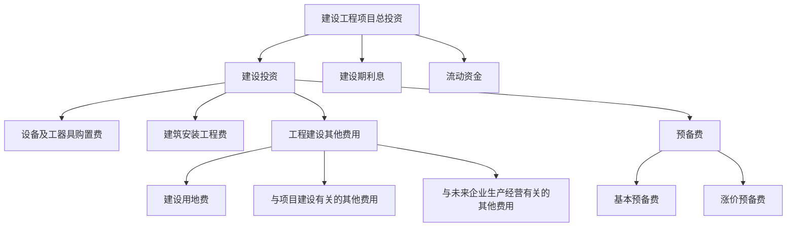
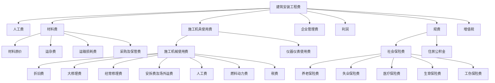
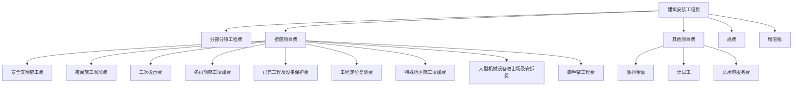
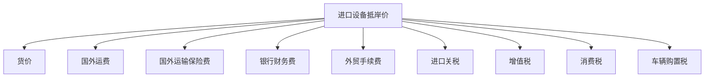

# 建设工程项目总投资

> [!important] 考点说明
> - **重要程度**：⭐⭐⭐⭐⭐
> - **历年分值**：6-8分
> - **考察形式**：单选 + 多选 + 计算
> - **真题年份**：每年必考，费用组成是核心

---

## 一、建设工程项目总投资的组成

### 1. 总投资构成

> [!note] 生产性建设项目
> 总投资 = 建设投资 + 建设期利息 + 流动资金
> 
> 非生产性建设项目
> 总投资 = 建设投资 + 建设期利息

---

## 二、建筑安装工程费用项目的组成

### 1. 按费用构成要素划分

> [!tip] 记忆口诀
> **人材机管利规税** —— 按费用构成要素的七大项

### 2. 按造价形成划分

> [!tip] 措施项目费记忆
> **二大爷脚已冬，特安定**
> - 二：二次搬运费
> - 大：大型机械设备进出场及安拆费
> - 爷：夜间施工增加费
> - 脚：脚手架工程费
> - 已：已完工程及设备保护费
> - 冬：冬雨期施工增加费
> - 特：特殊地区施工增加费
> - 安：安全文明施工费
> - 定：工程定位复测费

> [!important] 安全文明施工费
> - 环境保护费
> - 文明施工费
> - 安全施工费
> - 临时设施费
> - **不可竞争费用**

---

## 三、设备及工器具购置费

### 1. 设备购置费的组成
$$设备购置费 = 设备原价 + 设备运杂费$$

### 2. 国产设备原价
- **国产标准设备原价**：一般指设备制造厂的交货价，即出厂价
- **国产非标准设备原价**：有多种计算方法，如成本计算估价法、系列设备插入估价法等

### 3. 进口设备抵岸价的构成

> [!note] 到岸价（CIF）
> CIF = 货价（FOB）+ 国外运费 + 国外运输保险费

> [!warning] 税费计算基数
> - 银行财务费 → 离岸价（FOB）
> - 外贸手续费 → 到岸价（CIF）
> - 进口关税 → 到岸价（CIF）
> - 增值税 → （到岸价 + 关税 + 消费税）

---

## 四、工程建设其他费用

### 1. 建设用地费
- 土地使用费及补偿费
- 土地使用权出让金

### 2. 与项目建设有关的其他费用
- 建设管理费
- 可行性研究费
- 研究试验费
- 勘察设计费
- 环境影响评价费
- 劳动安全卫生评价费
- 场地准备及临时设施费
- 引进技术和进口设备其他费
- 工程保险费
- 特殊设备安全监督检验费
- 市政公用设施建设及绿化补偿费

### 3. 与未来企业生产经营有关的其他费用
- **联合试运转费**
- **生产准备费**
- **办公和生活家具购置费**

> [!warning] 联合试运转费注意
> - 不包括应由设备安装工程费用开支的调试及试车费用
> - 不包括在试运转中暴露出来的因施工原因或设备缺陷等发生的处理费用

---

## 五、预备费

### 1. 基本预备费
$$基本预备费 = (设备及工器具购置费 + 建筑安装工程费 + 工程建设其他费) \times 基本预备费费率$$

> [!note] 用途
> - 设计变更及施工过程中可能增加的工程量费用
> - 一般自然灾害造成的损失和预防自然灾害所采取的措施费用
> - 竣工验收时为鉴定工程质量对隐蔽工程进行必要的挖掘和修复费用

### 2. 涨价预备费
$$PC = \sum_{t=1}^{n} I_t[(1 + f)^t - 1]$$

- PC：涨价预备费
- $I_t$：第t年的建筑安装工程费、设备及工器具购置费之和
- f：建设期价格上涨指数
- n：建设期

---

## 六、建设期利息

### 计算公式
各年应计利息 = （年初借款本息累计 + 本年借款额/2）× 年利率

> [!example] 建设期利息计算
> 某项目建设期3年，共贷款1000万元，第1年贷款200万元，第2年贷款500万元，第3年贷款300万元，年利率6%：
> 
> 第1年：$200/2 \times 6\% = 6$ 万元
> 
> 第2年：$(200 + 6 + 500/2) \times 6\% = 27.36$ 万元
> 
> 第3年：$(200 + 6 + 500 + 27.36 + 300/2) \times 6\% = 53.00$ 万元
> 
> 建设期利息合计：$6 + 27.36 + 53.00 = 86.36$ 万元

---

## 📝 历年真题

> [!faq] 2023年真题
> **题目**：下列费用中，属于建筑安装工程费中企业管理费的是（  ）
> A. 医疗保险费
> B. 劳动保险费
> C. 住房公积金
> D. 养老保险费
> 
> **答案**：B

> [!faq] 2022年真题
> **题目**：根据《建筑安装工程费用项目组成》，属于安全文明施工费的有（  ）
> A. 环境保护费
> B. 文明施工费
> C. 临时设施费
> D. 夜间施工增加费
> E. 安全施工费
> 
> **答案**：ABCE

---

## 🔗 相关链接
- [[建设工程定额]]
- [[工程量清单计价]]
- [[建设工程经济]]

返回 [[首页]]
